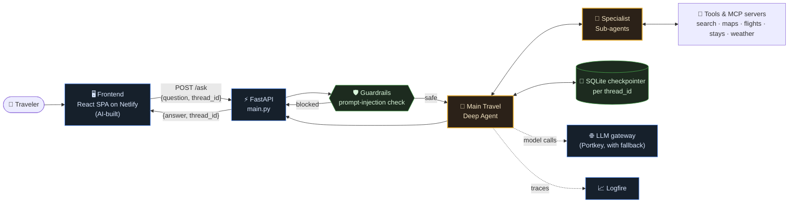
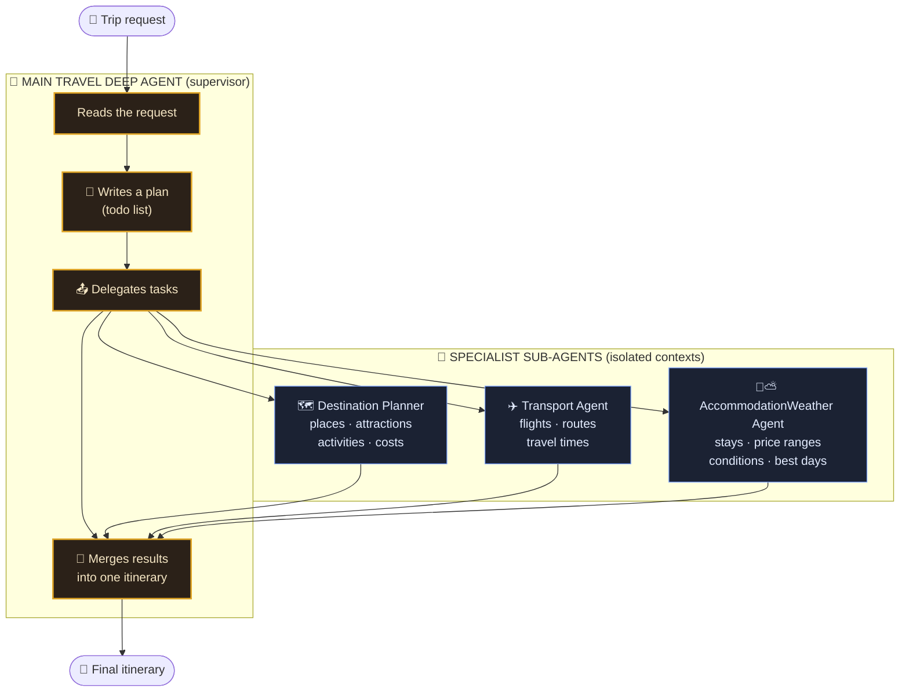
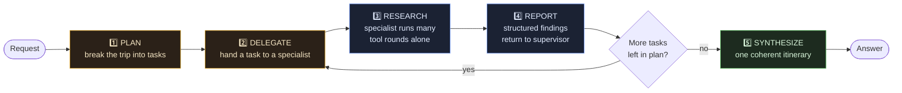
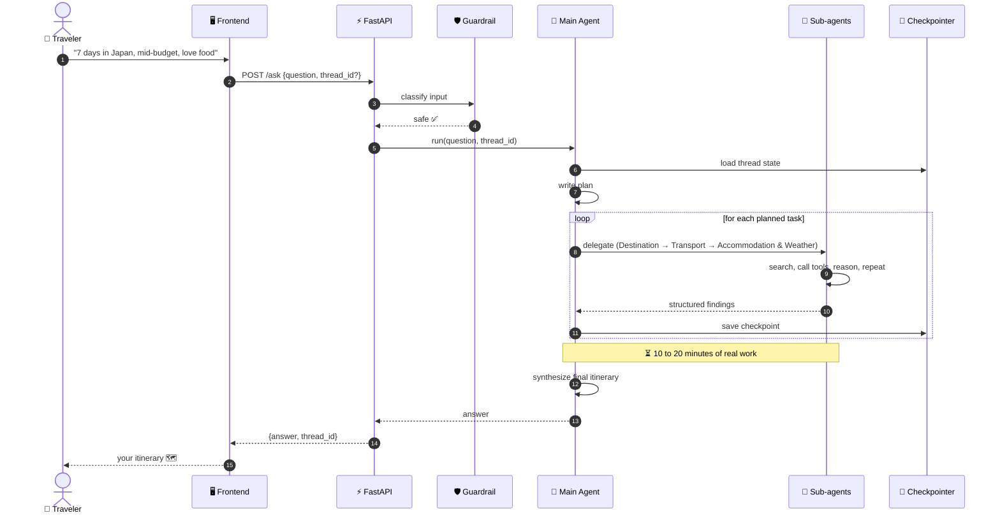

<div align="center">

# ✦ W A Y N O R A ✦

### A *deep agent* that plans your trip the slow, honest way

<p>
  
  
  
  
  
  <a href="https://waynora.netlify.app/"></a>
</p>

<sub>**1** supervisor &nbsp;·&nbsp; **3** specialist sub-agents &nbsp;·&nbsp; **0** fake progress bars</sub>

### [🌐 Try it live: waynora.netlify.app](https://waynora.netlify.app/)

</div>

---

> [!IMPORTANT]
> ### ⏳ Waynora takes **10 to 20 minutes** to answer, and that is on purpose
> This is not a chatbot that streams a quick guess. It is a **deep agent**: a supervisor that plans, delegates to specialist sub-agents, lets each one research on its own, then merges everything into one itinerary.
> Yes, 10 to 20 minutes is very high compared with a normal agent. It is the cost of **deep thinking + sub-agent architecture**, and the result is a researched plan instead of a confident hallucination. See [Why does it take so long?](#-why-does-it-take-so-long)

---

## 🧭 What is Waynora?

Waynora is an AI travel advisor for people planning custom, multi-day trips. You describe the trip; a team of agents researches destinations, transport, stays and weather, and hands back a complete itinerary.

It does **not** pretend to be instant. No fake percentages, no mock results, no invented "agent finished" checkmarks. The wait is real, so the product says so.

---

## ⚔️ Normal agent vs. Waynora's deep agent

| | 🤖 Normal agent | 🧠 Waynora (deep agent) |
|---|---|---|
| **Structure** | One model, a few tools | Supervisor + specialist sub-agents |
| **Planning** | Reacts step by step | Writes a plan first, then works through it |
| **Context** | One growing, messy context | Each sub-agent has its own clean, isolated context |
| **Research depth** | A search or two | Many tool rounds per specialist |
| **Output** | One-shot answer | Findings from every specialist merged into one plan |
| **Response time** | Seconds | **10 to 20 minutes** |
| **Quality goal** | Fast | Thorough and grounded in real data |

---

## 🏛️ Architecture at a glance



---

## 🌳 Agent structure

One **supervisor** owns the conversation. The specialists are not independent bots. They are sub-agents that only run when the supervisor delegates a task to them.



### The roster

| Agent | Job | What it works with |
|---|---|---|
| 🧠 **Main Travel Deep Agent** | Plans, delegates, reviews, writes the final itinerary | The sub-agents, conversation memory |
| 🗺️ **Destination Planner** | Finds areas, attractions, activities, costs and durations | OpenStreetMap tools, web search and page extraction |
| ✈️ **Transport Agent** | Works out how to get there and move around | Flight search (MCP) |
| 🏨⛅ **AccommodationWeather Agent** | Finds where to stay, what it costs, and checks conditions for the travel dates | Stay search, weather tools |

> Specialists return **structured results** (not free-form chat), so the supervisor can merge them reliably.

---

## 🔁 Inside the deep agent loop

What makes it "deep" is the loop, not the model.



Each lap through steps 2 to 4 is many model calls and many tool calls. That is where the time goes.

---

## 📡 Life of one request



---

## 🐢 Why does it take so long?

Because the work is real. A single reply involves:

1. **Planning**: the supervisor breaks your request into tasks before doing anything.
2. **Sequential dependencies**: you cannot pick a hotel area before the destination is chosen, and you cannot price transport before you know the route.
3. **Many tool rounds per specialist**: search, open a page, extract, query a map, search again. Each round is another model call.
4. **Isolated contexts**: every sub-agent starts clean and does its own reasoning instead of sharing one overloaded context. Cleaner thinking, but more total calls.
5. **Synthesis**: the supervisor reconciles everything into a single consistent itinerary.
6. **Synchronous by design**: `POST /ask` returns only when the whole job is finished. No partial or fabricated output in between.

```mermaid
gantt
    title Illustrative shape of one run (not a measured benchmark)
    dateFormat HH:mm
    axisFormat %M min
    section Supervisor
    Plan the trip            :done, p1, 00:00, 00:02
    Merge and write itinerary :active, p2, 00:16, 00:19
    section Specialists
    Destination research     :s1, 00:02, 00:08
    Transport research       :s2, 00:08, 00:12
    Accommodation + weather research :s3, 00:12, 00:16
```



> [!NOTE]
> **Trade-off, stated plainly:** a normal agent answers in seconds and is often shallow. Waynora spends 10 to 20 minutes so the answer is researched, cross-checked and complete. If you need speed, this is the wrong tool. If you need depth, this is the point.

---

## 🛡️ Guardrails and reliability

```mermaid
flowchart LR
    IN(["Input"]) --> PI["🛡️ Prompt-injection<br/>classifier<br/>safe / unsafe"]
    PI --> LIM["🔢 Tool-call limit<br/>stops runaway loops"]
    LIM --> LLM["🌐 Gateway<br/>automatic model fallback"]
    LLM --> STR["🧱 Structured outputs<br/>validated schemas"]
    STR --> CK["💾 Checkpoints<br/>resume by thread_id"]
    CK --> OBS["📈 Observability<br/>traces in Logfire"]
    OBS --> OUT(["Output"])

    style PI fill:#2b1d1d,stroke:#ff6b6b,color:#ffdede
    style LIM fill:#2b2118,stroke:#e0a526,color:#f5e6c4
    style LLM fill:#16202b,stroke:#4c8dff,color:#dbe8ff
    style STR fill:#1b2233,stroke:#7aa2ff,color:#e3ecff
    style CK fill:#1d2b1f,stroke:#4caf50,color:#d8f5da
    style OBS fill:#1d2b1f,stroke:#4caf50,color:#d8f5da
```



- **Prompt-injection check** runs before the agent starts.
- **Tool-call limits** keep a specialist from looping forever.
- **Gateway fallback**: if the primary model fails, the request moves to a backup model.
- **Structured outputs** keep sub-agent results machine-readable.
- **Persistent memory**: conversations continue by `thread_id` using an async SQLite checkpointer.
- **Tracing**: every run is observable through Logfire.
- **Evals**: reviewed manually with an LLM-as-judge approach. Real inputs and the agent's full outputs were given to ChatGPT for evaluation, because the outputs are long enough that DeepEval's judge model could not process them reliably.
---
---

## 🧪 Evaluation

Waynora's answers are long, multi-section itineraries, so automated eval tooling struggled with them. DeepEval repeatedly failed on the full outputs because the judge model could not handle their size.

What I did instead:

- Ran real trip requests through the live agent.
- Gave each **input** and the agent's **actual output** to ChatGPT as a judge.
- Reviewed the verdicts myself.

**Known limitation:** this is a manual, small-scale review, not an automated benchmark. A next step is to split each itinerary into sections and run automated checks per section, so the outputs fit a judge model's context.

---

## 🔌 API

| Method | Route | Body | Returns |
|---|---|---|---|
| `POST` | `/ask` | `{ "question": "...", "thread_id": "optional" }` | `{ "answer": "...", "thread_id": "..." }` |
| `GET` | `/health` | none | `{ "status": "ok" }` |

- Omit `thread_id` to start a new conversation; reuse the returned one to continue it.
- The request is **synchronous**, so make sure every client, proxy and load balancer in front of it allows a timeout of **at least 20 minutes**.


---

## 🧰 Tech stack

| Layer | Tools |
|---|---|
| **Agent framework** | `deepagents`, `langchain`, `langgraph` |
| **Tool integration** | MCP via `langchain-mcp-adapters`, `flights`, `stays`, `ddgs`, `parallel-web` |
| **API** | FastAPI, Uvicorn |
| **Memory** | `langgraph-checkpoint-sqlite` (async SQLite) |
| **Gateway** | Portkey |
| **Guardrails** | `langchain-typesafe` classifier as agent middleware |
| **Observability** | Logfire |
| **Evaluation** | Manual LLM-as-judge review (ChatGPT) on real input/output pairs |
| **Frontend hosting** | Netlify |
| **Packaging** | `uv`, Docker (Python 3.12, Node.js for MCP servers) |

---

## 🗂️ Project structure

```text
Waynora/
├── 📁 app/                      ← the backend (all the agent logic)
│   ├── 📁 agents/
│   │   └── 📁 Deep_agent/
│   │       └── 🧠 travel_agent.py   # builds the main deep agent + ask()
│   ├── 📁 api/
│   │   └── 📄 model.py              # AskRequest / AskResponse
│   └── 📁 db/
│       └── 💾 checkpoints.db        # created at runtime
├── 📁 frontend/                 ← AI-built UI (see note below)
├── 📁 docs/
├── ⚡ main.py                    # FastAPI app, lifespan, /ask, /health
├── 🐳 Dockerfile
├── 📦 pyproject.toml / uv.lock
└── 📘 PRODUCT.md                # product principles
```

---

## 🌐 Live demo

Waynora is deployed. Nothing to install: **[waynora.netlify.app](https://waynora.netlify.app/)**

Ask for a trip, then keep the tab open. The reply takes 10 to 20 minutes because the agents are doing real research.

---

## 🎨 About the frontend

The frontend in `/frontend` was **built with AI**, using the *Get Shit Done* workflow and a frontend design skill, driven by repeated, detailed instructions.

**The plan was mine:** the product idea, the agent architecture, the honest-waiting concept and how everything should be built. AI wrote the UI code; I directed it. That is why this README focuses on the backend in `/app`, which is where the engineering lives.

---

<div align="center">

### Built by **[Yadav Nitesh](https://github.com/yadavnitesh86)**

<sub>Deep agents are slow because thinking is slow. ✦ Good trips are worth the wait.</sub>

</div>
