# Component Diagram

## Overview

This diagram shows the software components and their dependencies, with clear boundaries between the frontend, backend, orchestration, specialist agents, middleware, MCP integrations, external services, and persistence.

```mermaid
graph TB
    subgraph "Frontend Layer"
        App[App.tsx<br/>RouterProvider]
        RootLayout[RootLayout<br/>App Shell]
        Landing[Landing Page]
        Auth[Auth Pages<br/>SignIn / SignUp]
        Chat[Chat Page]
        WaitingShell[WaitingShell<br/>2048 Game]
        UI[UI Primitives<br/>Button, Spinner, etc.]
        AuthProvider[AuthProvider<br/>Convex Context]
        APIClient[API Client<br/>lib/api/ask.ts]
        ReqController[Request Controller<br/>lib/chat/]
        CookieRepo[Cookie Repository<br/>lib/cookie/]
        GameEngine[2048 Engine<br/>lib/game/]
    end

    subgraph "Backend Layer"
        FastAPI[FastAPI App<br/>main.py]
        Endpoint[POST /ask Endpoint]
        CORS[CORS Middleware]
        Lifespan[Application Lifespan]
        Models[Pydantic Models<br/>app/api/model.py]
    end

    subgraph "Orchestration Layer"
        DeepAgent[Main Deep Agent<br/>travel_agent.py]
        SystemPrompt[System Prompt<br/>Orchestration Rules]
        LLMConfig[LLM Config<br/>portkey/llm.py]
    end

    subgraph "Middleware Layer"
        PI[PromptInjection Middleware<br/>TypeSafe Classifier]
        ISO[Isolate Subagent Errors<br/>wrap_tool_call]
        SUM[Summarization Middleware<br/>Token Trigger]
        PII[PII Middleware<br/>Multiple Instances]
    end

    subgraph "Specialist Agent Layer"
        DestAgent[Destination Subagent]
        TransAgent[Transport Subagent]
        AWAgent[Accommodation/Weather Subagent]
        DestSchema[Destination Schema<br/>Pydantic]
        TransSchema[Transport Schema<br/>Pydantic]
        AWSchema[AW Schema<br/>Pydantic]
        DestMW[Destination Middleware<br/>ToolCallLimit]
        TransMW[Transport Middleware<br/>ToolCallLimit]
    end

    subgraph "MCP Integration Layer"
        MCPClient[MultiServerMCPClient<br/>langchain_mcp_adapters]
        TavilyMCP[Tavily Remote MCP]
        HotelsMCP[Google Hotels MCP]
        FlightsMCP[Google Flights MCP]
        MapsMCP[Google Maps MCP]
        WeatherMCP[Weather MCP]
        TrainMCP[Custom Train MCP<br/>FastMCP Server]
    end

    subgraph "External Service Layer"
        TavilyAPI[Tavily Search API]
        HotelsAPI[Google Hotels API]
        FlightsAPI[Google Flights API]
        MapsAPI[Google Maps API]
        WeatherAPI[Weather API]
        TrainAPI[Indian Railway API]
    end

    subgraph "Persistence Layer"
        SQLite[(AsyncSqliteSaver<br/>SQLite)]
        Cookies[(Browser Cookies<br/>Versioned, Chunked)]
        Convex[(Convex Auth<br/>User Data)]
    end

    subgraph "Observability Layer"
        Logfire[Logfire Tracing]
        Portkey[Portkey LLM Routing]
    end

    %% Frontend internal dependencies
    App --> RootLayout
    RootLayout --> Landing
    RootLayout --> Auth
    RootLayout --> Chat
    RootLayout --> UI
    AuthProvider --> Auth
    Chat --> WaitingShell
    Chat --> APIClient
    Chat --> ReqController
    Chat --> CookieRepo
    WaitingShell --> GameEngine
    CookieRepo --> Cookies

    %% Frontend to Backend
    APIClient -->|HTTP POST /ask| Endpoint
    AuthProvider -->|Auth Token| Convex

    %% Backend internal
    FastAPI --> Endpoint
    FastAPI --> CORS
    FastAPI --> Lifespan
    Endpoint --> Models
    Lifespan --> DeepAgent

    %% Backend to Orchestration
    Endpoint --> DeepAgent
    DeepAgent --> SystemPrompt
    DeepAgent --> LLMConfig
    LLMConfig --> Portkey

    %% Orchestration to Middleware
    DeepAgent --> PI
    DeepAgent --> ISO
    DeepAgent --> SUM
    DeepAgent --> PII

    %% Orchestration to Subagents
    DeepAgent --> DestAgent
    DeepAgent --> TransAgent
    DeepAgent --> AWAgent

    %% Subagent schemas
    DestAgent --> DestSchema
    TransAgent --> TransSchema
    AWAgent --> AWSchema

    %% Subagent middleware
    DestAgent --> DestMW
    TransAgent --> TransMW

    %% Subagents to MCP
    DestAgent --> MCPClient
    TransAgent --> MCPClient
    AWAgent --> MCPClient

    %% MCP to MCP Servers
    MCPClient --> TavilyMCP
    MCPClient --> HotelsMCP
    MCPClient --> FlightsMCP
    MCPClient --> MapsMCP
    MCPClient --> WeatherMCP
    MCPClient --> TrainMCP

    %% MCP Servers to External APIs
    TavilyMCP --> TavilyAPI
    HotelsMCP --> HotelsAPI
    FlightsMCP --> FlightsAPI
    MapsMCP --> MapsAPI
    WeatherMCP --> WeatherAPI
    TrainMCP --> TrainAPI

    %% Persistence
    DeepAgent <--> SQLite
    CookieRepo <--> Cookies
    AuthProvider <--> Convex

    %% Observability
    DeepAgent -.-> Logfire
    DestAgent -.-> Logfire
    TransAgent -.-> Logfire
    AWAgent -.-> Logfire
```

## Component Descriptions

### Frontend Layer

| Component | File | Responsibility |
|-----------|------|----------------|
| App.tsx | `frontend/src/App.tsx` | Root component, provides RouterProvider |
| RootLayout | `frontend/src/layouts/RootLayout.tsx` | App shell with header, main, footer |
| Landing Page | `frontend/src/routes/Landing.tsx` | Marketing page with product information |
| Auth Pages | `frontend/src/routes/SignIn.tsx`, `SignUp.tsx` | Authentication forms |
| Chat Page | `frontend/src/routes/Chat.tsx` | Main chat interface |
| WaitingShell | `frontend/src/components/chat/WaitingShell.tsx` | Waiting experience with 2048 |
| UI Primitives | `frontend/src/components/ui/` | Shared UI components |
| AuthProvider | `frontend/src/auth/AuthProvider.tsx` | Convex Auth context |
| API Client | `frontend/src/lib/api/ask.ts` | Backend communication |
| Request Controller | `frontend/src/lib/chat/requestController.ts` | Request lifecycle management |
| Cookie Repository | `frontend/src/lib/cookie/` | Chat history persistence |
| 2048 Engine | `frontend/src/lib/game/2048/engine.ts` | Game logic |

### Backend Layer

| Component | File | Responsibility |
|-----------|------|----------------|
| FastAPI App | `main.py` | Application factory, CORS, lifespan |
| POST /ask | `main.py` | Single API endpoint |
| Pydantic Models | `app/api/model.py` | Request/response validation |

### Orchestration Layer

| Component | File | Responsibility |
|-----------|------|----------------|
| Main Deep Agent | `app/agents/Deep_agent/travel_agent.py` | Central orchestrator |
| System Prompt | `travel_agent.py` (SYSTEM_PROMPT) | Orchestration rules |
| LLM Config | `app/portkey/llm.py` | Model routing via Portkey |

### Middleware Layer

| Component | File | Responsibility |
|-----------|------|----------------|
| PromptInjection | `app/agents/Deep_agent/Middleware.py` | TypeSafe classifier |
| Isolate Errors | `Middleware.py` | Error containment |
| Summarization | `Middleware.py` | Context management |
| PII Protection | `Middleware.py` | Multiple PII middleware instances |

### Specialist Agent Layer

| Component | File | Responsibility |
|-----------|------|----------------|
| Destination | `app/agents/sub_agent/Destination_subagent/` | Destination research |
| Transport | `app/agents/sub_agent/Transport_subagent/` | Transport research |
| Accommodation/Weather | `app/agents/sub_agent/AccommodationWeather_subagent/` | Hotel/weather research |

### MCP Integration Layer

| Component | File | Responsibility |
|-----------|------|----------------|
| MultiServerMCPClient | `langchain_mcp_adapters` | MCP connection management |
| Tavily MCP | Remote MCP via npx | Web search |
| Google Hotels MCP | stdio (stays mcp) | Hotel search |
| Google Flights MCP | stdio | Flight search |
| Google Maps MCP | stdio | Route computation |
| Weather MCP | stdio | Weather forecast |
| Custom Train MCP | `app/agents/sub_agent/Transport_subagent/server.py` | Indian train search |

## Key Design Decisions

1. **Clear layer boundaries**: Each layer has a specific responsibility and communicates only with adjacent layers.

2. **Middleware as a separate layer**: Middleware components are distinct from the agent, allowing cross-cutting concerns to be added or removed independently.

3. **MCP as an integration layer**: MCP servers are abstracted behind the MultiServerMCPClient, making it easy to add or remove tools without changing agent code.

4. **Persistence separation**: Three distinct persistence mechanisms — SQLite (backend checkpointer), browser cookies (chat history), and Convex (authentication) — each serving a specific purpose.

5. **Observability as a cross-cutting concern**: Logfire tracing is used across all agent components without being tightly coupled to any specific layer.
