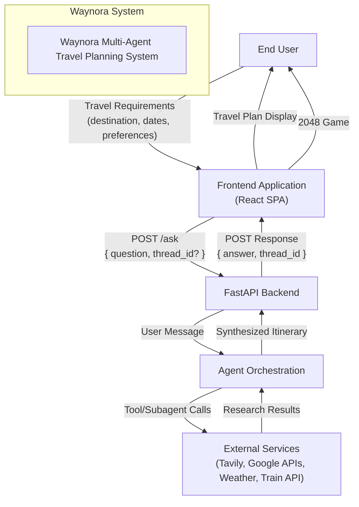

# DFD Level 0 — Context-Level Data Flow Diagram

## Overview

The Level 0 DFD (also called the Context Diagram) shows the Waynora system as a single process, with all external entities and major data flows.

## External Entities

| Entity | Description | Inputs to System | Outputs from System |
|--------|-------------|------------------|---------------------|
| **End User** | Travel planner using the application | Travel requirements, chat messages | Travel itinerary, waiting experience |
| **Frontend Application** | React SPA running in browser | User input, API responses | API requests, rendered UI |
| **FastAPI Backend** | Python API server | HTTP requests | HTTP responses |
| **Agent Orchestration** | Deep Agent + Subagents | User messages, tool results | Itinerary text, tool calls |
| **External Services** | Third-party APIs | API queries | Search results, flight/hotel/train data |

## Data Flows

### Primary Data Flows

1. **User → Frontend**: Travel requirements entered through chat interface
2. **Frontend → Backend**: `POST /ask` with question and optional thread_id
3. **Backend → Agent**: User message passed to main Deep Agent
4. **Agent → External Services**: MCP tool calls for research
5. **External Services → Agent**: Research results (destinations, flights, hotels, weather, trains)
6. **Agent → Backend**: Synthesized travel itinerary
7. **Backend → Frontend**: `POST /ask` response with answer and thread_id
8. **Frontend → User**: Travel plan displayed in chat interface

### Supporting Data Flows

9. **Frontend → User**: 2048 game during waiting state
10. **Frontend ↔ Browser Cookies**: Chat history persistence

## Design Decisions

1. **Single process representation**: The entire system is shown as one process at this level, with internal details hidden.

2. **External entities are outside the system boundary**: The frontend, backend, and agent orchestration are all part of the Waynora system, while external services (Tavily, Google APIs) are external entities.

3. **Bidirectional flows with external services**: The agent both sends queries and receives results from external services.

4. **No internal data stores shown**: The checkpointer (AsyncSqliteSaver) and cookie persistence are internal to the system and not shown at the context level.
