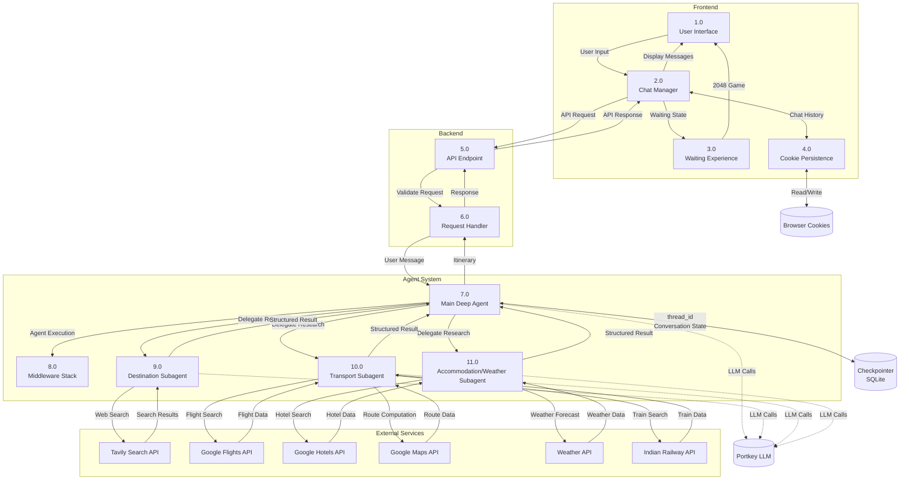

# DFD Level 1 — Data Flow Diagram

## Overview

The Level 1 DFD decomposes the Waynora system into major processes, data stores, and data flows. This provides more detail than the context diagram while remaining readable.

## Process Descriptions

### Frontend Processes

| Process | Name | Description |
|---------|------|-------------|
| 1.0 | User Interface | Renders landing page, auth pages, chat interface |
| 2.0 | Chat Manager | Manages conversation state, message display, API communication |
| 3.0 | Waiting Experience | Shows elapsed time, dynamic messages, and 2048 game |
| 4.0 | Cookie Persistence | Reads/writes versioned, chunked chat history to browser cookies |

### Backend Processes

| Process | Name | Description |
|---------|------|-------------|
| 5.0 | API Endpoint | FastAPI `POST /ask` endpoint with Pydantic validation |
| 6.0 | Request Handler | Validates request, manages thread_id, invokes agent, returns response |

### Agent System Processes

| Process | Name | Description |
|---------|------|-------------|
| 7.0 | Main Deep Agent | Orchestrator that plans, delegates, synthesizes, and validates |
| 8.0 | Middleware Stack | Prompt injection detection, error isolation, summarization, PII protection |
| 9.0 | Destination Subagent | Researches attractions, activities, neighborhoods |
| 10.0 | Transport Subagent | Researches flights, Indian trains, routes |
| 11.0 | Accommodation/Weather Subagent | Researches hotels and weather |

## Data Stores

| Store | Type | Description |
|-------|------|-------------|
| Checkpointer | SQLite (AsyncSqliteSaver) | Persists conversation state via thread_id |
| Browser Cookies | Client-side | Stores chat history with versioning and chunking |
| Portkey LLM | External Service | Routes LLM calls to appropriate models |

## Data Flows (Key)

1. **User Input → Chat Manager → API Endpoint**: Travel requirements flow from UI to backend
2. **API Endpoint → Request Handler → Main Agent**: Validated request passed to agent
3. **Main Agent → Subagents → External Services**: Research delegation and data retrieval
4. **Subagents → Main Agent**: Structured Pydantic results returned
5. **Main Agent → Request Handler → API Endpoint → Chat Manager**: Synthesized itinerary returned
6. **Chat Manager ↔ Cookie Persistence**: Chat history saved and restored

## Consistency with Level 0

This Level 1 DFD is consistent with the Level 0 context diagram:
- The single "Waynora System" process is decomposed into 11 processes
- All external entities from Level 0 are represented
- All data flows from Level 0 are preserved and elaborated
- No new external entities are introduced
