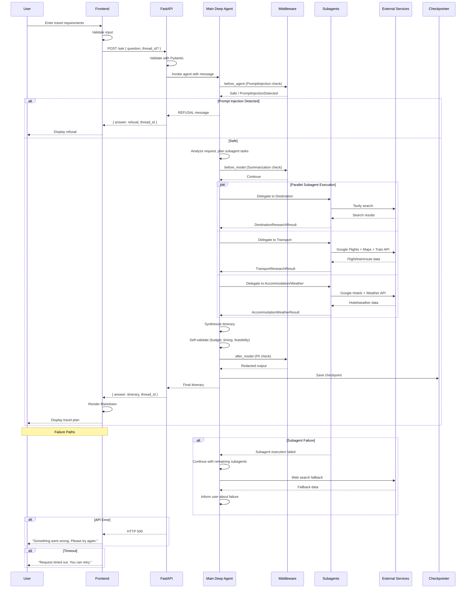

# Sequence Diagram

## Overview

This diagram shows the complete request lifecycle, from user input through the frontend, FastAPI backend, main agent, specialist subagents, and external services, including failure paths.

## Sequence Description

### Happy Path (Normal Flow)

1. **User Input**: User enters travel requirements in the chat composer
2. **Frontend Validation**: Input is validated (non-empty, proper format)
3. **API Request**: Frontend sends `POST /ask` with question and optional thread_id
4. **Pydantic Validation**: FastAPI validates the request body
5. **Agent Invocation**: Main Deep Agent receives the message
6. **Prompt Injection Check**: Middleware evaluates the message for injection attempts
7. **Planning**: Agent analyzes the request and plans subagent tasks
8. **Parallel Subagent Execution**: Independent subagents are invoked simultaneously
9. **External Research**: Subagents query external services for data
10. **Structured Results**: Subagents return Pydantic-validated results
11. **Synthesis**: Main agent combines all research into a coherent itinerary
12. **Self-Validation**: Agent checks budget, timing, and feasibility
13. **PII Check**: Middleware redacts any sensitive information
14. **Checkpoint Save**: Conversation state saved to SQLite
15. **Response**: Itinerary returned to frontend
16. **Markdown Rendering**: Frontend renders the itinerary with formatting
17. **Display**: User sees the complete travel plan

### Failure Paths

#### Subagent Failure
- A subagent fails (MCP tool error, timeout, or API failure)
- `isolate_subagent_errors` middleware catches the exception
- Failure marker returned to main agent
- Main agent continues with remaining subagents
- Web search used as fallback for missing data
- User informed about the failure in the response

#### API Error
- Unhandled exception in the agent
- FastAPI catches and returns HTTP 500
- Frontend displays user-friendly error message
- User's input is preserved for retry

#### Timeout
- Frontend's 15-minute timeout is reached
- AbortController cancels the fetch request
- User informed about the timeout
- Note: Server-side agent may continue executing

## Design Decisions

1. **Synchronous request-response**: The entire flow is synchronous — the frontend waits for the complete response. There is no streaming or polling.

2. **Parallel subagent execution**: Independent subagents run concurrently to minimize total planning time. This is a key performance optimization.

3. **Middleware at multiple points**: Middleware runs before the agent (prompt injection), before the model (summarization), and after the model (PII check).

4. **Graceful degradation**: When a subagent fails, the system continues with remaining subagents and uses web search as a fallback. The user is informed but not blocked.

5. **No cancellation guarantee**: The frontend timeout cancels the HTTP request, but the server-side agent may continue executing. This is an honest limitation of the architecture.
