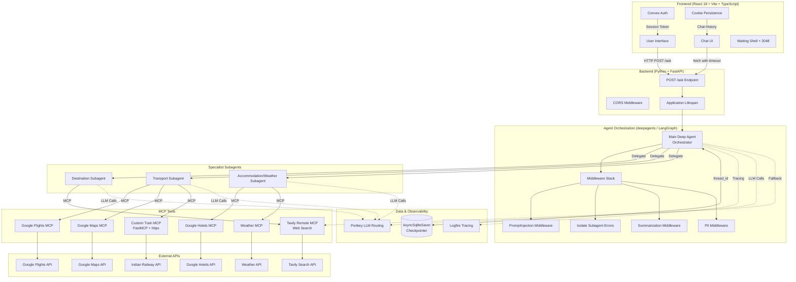

# System Architecture

## End-to-End Architecture Diagram

This diagram shows the complete Waynora system architecture, from the frontend user interface through the FastAPI backend to the multi-agent AI system and external services.

## Architecture Description

### Frontend Layer

The frontend is a React 18 SPA built with Vite and TypeScript. It communicates with the backend exclusively through the `POST /ask` endpoint. Key components:

- **AuthProvider**: Manages Convex authentication state
- **Chat UI**: Displays conversations with Markdown rendering
- **Waiting Shell**: Shows elapsed time, dynamic messages, and the 2048 game
- **Cookie Persistence**: Stores chat history in versioned, chunked browser cookies

### Backend Layer

The FastAPI application provides a single endpoint for all interactions:

- **POST /ask**: Accepts `{ question, thread_id? }` and returns `{ answer, thread_id }`
- **CORS Middleware**: Allows cross-origin requests from the frontend
- **Application Lifespan**: Initializes the agent and checkpointer on startup

### Agent Orchestration Layer

The main Deep Agent (built with the `deepagents` library) serves as the central orchestrator:

- **System Prompt**: Defines the orchestration workflow, subagent rules, and failure handling
- **Middleware Stack**: Handles security, error isolation, context management, and privacy
- **Subagent Delegation**: Selects and invokes specialist subagents for research

### Specialist Subagents

Three specialist subagents handle domain-specific research:

1. **Destination Subagent**: Researches attractions, activities, neighborhoods via Tavily MCP
2. **Transport Subagent**: Researches flights, Indian trains, and routes via Google Flights, Google Maps, and custom Train MCP
3. **Accommodation/Weather Subagent**: Researches hotels and weather via Google Hotels and Weather MCP

### Data and Observability

- **AsyncSqliteSaver**: Persists conversation state via checkpointer
- **Logfire**: Provides tracing and observability for agent execution
- **Portkey**: Routes LLM calls to appropriate models (heavy for main agent, lite for subagents)

## Key Design Decisions

1. **Single endpoint architecture**: The entire travel planning process is one synchronous conversation, simplifying the API contract.

2. **Middleware-based cross-cutting concerns**: Security, error handling, summarization, and PII protection are implemented as middleware, keeping the agent logic clean.

3. **Parallel subagent execution**: Independent subagent tasks run in parallel to minimize total planning time.

4. **Structured outputs**: All subagents return Pydantic-validated responses, ensuring consistent data for the main agent.

5. **Client-side persistence**: Chat history is stored in browser cookies, not in a database, respecting user privacy.

6. **Honest waiting experience**: No fake progress indicators — just transparent communication about the time required.

7. **Custom MCP for Indian trains**: When no suitable MCP existed, a custom server was built using FastMCP.
