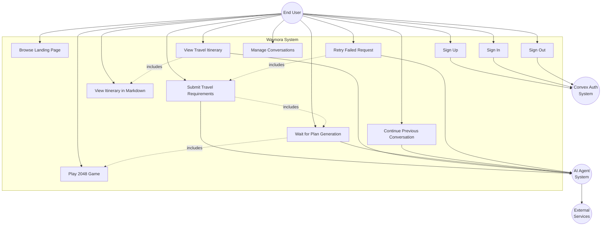

# Use Case Diagram

## Overview

This diagram shows the actors and supported use cases in the Waynora system. It reflects the actual implemented functionality.

## Actor Descriptions

### Primary Actor: End User

The end user is a traveler who uses Waynora to plan trips. They interact with the system through the React frontend.

**Goals:**
- Plan a comprehensive multi-day trip
- Receive honest, research-based travel recommendations
- Have an engaging experience during the 5–15 minute planning time
- Manage multiple trip planning conversations

### Secondary Actor: Convex Auth System

Handles user authentication and session management.

**Responsibilities:**
- User registration with email/password
- User login and session token management
- User logout
- Protected route enforcement

### Secondary Actor: AI Agent System

The multi-agent system that processes travel requests.

**Responsibilities:**
- Analyze travel requirements
- Delegate research to specialist subagents
- Synthesize results into comprehensive itineraries
- Handle failures gracefully

### Secondary Actor: External Services

Third-party APIs that provide travel data.

**Services:**
- Tavily Search API (destination research)
- Google Flights API (flight search)
- Google Hotels API (accommodation search)
- Google Maps API (route computation)
- Weather API (forecast data)
- Indian Railway API (train search)

## Use Case Descriptions

### UC1: Browse Landing Page

- **Actor**: End User
- **Precondition**: None
- **Flow**: User visits the landing page, learns about Waynora's capabilities, sees the value proposition
- **Postcondition**: User understands what Waynora does

### UC2: Sign Up

- **Actor**: End User
- **Precondition**: User is not authenticated
- **Flow**: User enters email and password, form validates input, Convex Auth creates account
- **Postcondition**: User is authenticated and redirected to chat

### UC3: Sign In

- **Actor**: End User
- **Precondition**: User is not authenticated
- **Flow**: User enters email and password, Convex Auth validates credentials
- **Postcondition**: User is authenticated and redirected to chat

### UC4: Sign Out

- **Actor**: End User
- **Precondition**: User is authenticated
- **Flow**: User clicks logout, Convex Auth ends session
- **Postcondition**: User is redirected to landing page

### UC5: Submit Travel Requirements

- **Actor**: End User
- **Precondition**: User is authenticated
- **Flow**: User enters travel details (destination, dates, preferences, budget) in chat composer, submits request
- **Postcondition**: Request sent to backend, waiting state begins

### UC6: View Travel Itinerary

- **Actor**: End User
- **Precondition**: Request has been processed
- **Flow**: Backend returns synthesized itinerary, frontend renders it with Markdown
- **Postcondition**: User can read the complete travel plan

### UC7: Wait for Plan Generation

- **Actor**: End User
- **Precondition**: Request has been submitted
- **Flow**: Elapsed time displayed, dynamic messages shown, user informed about 5–15 minute wait
- **Postcondition**: User is engaged during the wait

### UC8: Play 2048 Game

- **Actor**: End User
- **Precondition**: Request is actively waiting
- **Flow**: User plays 2048 using keyboard or touch controls
- **Postcondition**: User is entertained during the wait

### UC9: Manage Conversations

- **Actor**: End User
- **Precondition**: User is authenticated
- **Flow**: User creates new chats, switches between conversations, renames or deletes chats
- **Postcondition**: Conversations are organized as desired

### UC10: Continue Previous Conversation

- **Actor**: End User
- **Precondition**: Previous conversation exists
- **Flow**: User selects a previous chat, conversation history loaded from cookies, user can continue the conversation
- **Postcondition**: Conversation context is restored

### UC11: View Itinerary in Markdown

- **Actor**: End User
- **Precondition**: Itinerary has been generated
- **Flow**: Itinerary rendered with Markdown formatting, tables, and lists
- **Postcondition**: Itinerary is readable and well-formatted

### UC12: Retry Failed Request

- **Actor**: End User
- **Precondition**: Previous request failed
- **Flow**: User clicks retry, new request submitted with same parameters
- **Postcondition**: New request is processed

## Design Decisions

1. **No admin use cases**: The system does not have administrative functionality. User management is handled by Convex Auth.

2. **No direct external service interaction**: Users never interact directly with external services. All external data access is mediated by the AI agent system.

3. **Waiting as a use case**: The waiting experience is explicitly modeled as a use case because it is a core part of the user experience, not just a side effect.

4. **2048 as an include**: Playing the 2048 game is included in the waiting use case, not a standalone use case, because it only occurs during the waiting state.

5. **Retry includes submit**: Retrying a failed request includes submitting travel requirements, as it is essentially the same operation.
